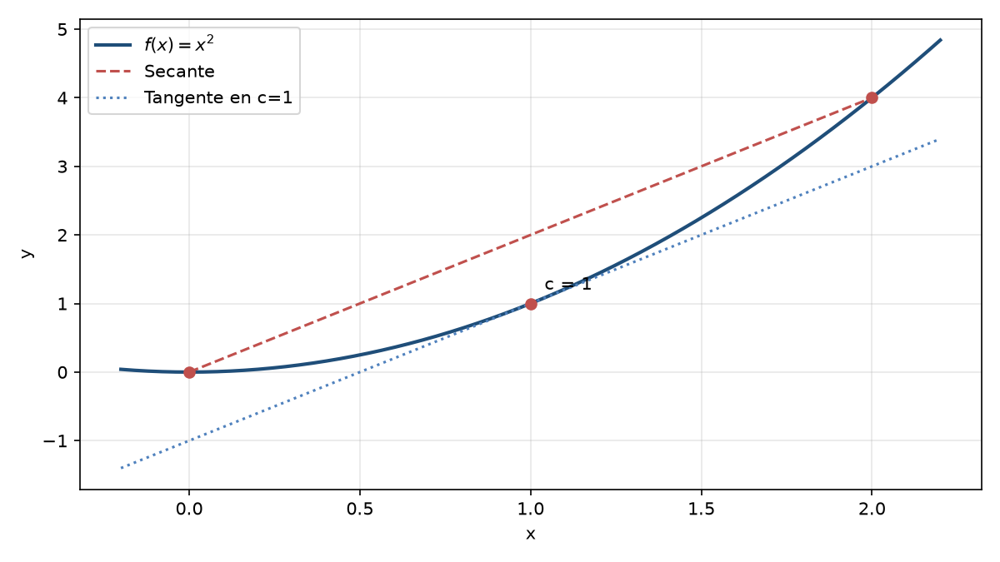

## ¿Qué es el TVM?

Intuición: si una función es continua y derivable, en algún punto interior la **recta tangente** es paralela a la **secante** que une los extremos del intervalo.

## Enunciado formal

::: {.incremental}
- **Hipótesis:** $f$ continua en $[a,b]$ y derivable en $(a,b)$
- **Tesis:** existe al menos un $c\in(a,b)$
- **Conclusión:** $f'(c)=\dfrac{f(b)-f(a)}{b-a}$
:::

## Interpretación geométrica

{width=70%}

La tangente en $c=1$ es paralela a la secante entre $x=0$ y $x=2$.

## Aplicaciones

- Aproximación de funciones
- Demostración de desigualdades
- Regla de L'Hôpital
- Estimación de errores